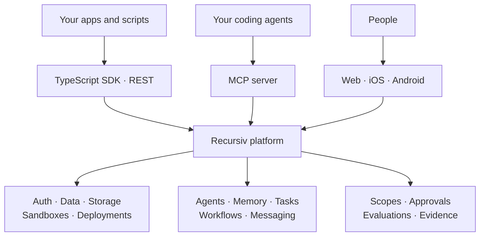

<p align="center">
  
  
</p>

<h1 align="center">Build, run, and govern AI agents.</h1>

<p align="center">
  The platform for agents, the apps they build, and the people in control.
</p>

<p align="center">
  <a href="https://recursiv.io"><b>Website</b></a> ·
  <a href="https://docs.recursiv.io"><b>Documentation</b></a> ·
  <a href="https://docs.recursiv.io/guides/start-here/quickstart"><b>Quickstart</b></a> ·
  <a href="https://docs.recursiv.io/api-reference"><b>API reference</b></a>
</p>

<p align="center">
  <a href="https://www.npmjs.com/package/@recursiv/sdk"></a>
  <a href="https://www.npmjs.com/package/@recursiv/mcp"></a>
  <a href="LICENSE"></a>
</p>

---

Recursiv brings **app infrastructure, agent coordination, and human oversight**
into one platform. Build with auth, Postgres, storage, sandboxes, and deployments.
Give agents memory, tools, and a shared task queue. Review their work through
approvals, evaluations, and recorded evidence.

Use the TypeScript SDK, REST API, CLI, or Model Context Protocol (MCP) server. The platform includes a server, web and mobile client, developer tools, and app templates.
Minds also runs on this server.

The main platform repository is currently private. Public documentation,
SDK and MCP packages, and starter templates are available now.
**Self-hosting requires access to the platform source.**

## Start here

| You want to… | Start with |
| :--- | :--- |
| **Build an app** | [Quickstart](https://docs.recursiv.io/guides/start-here/quickstart) · [Next.js template](https://github.com/recursivlabs/template-nextjs) · [Expo template](https://github.com/recursivlabs/template-expo) |
| **Connect a coding agent** | [MCP setup](https://docs.recursiv.io/guides/ai-tools/mcp-claude-cursor) · [Machine-readable docs](https://docs.recursiv.io/llms.txt) |
| **Use the API in code** | [TypeScript SDK](https://docs.recursiv.io/sdk/setup/installation-configuration) · [OpenAPI specification](https://docs.recursiv.io/openapi.json) |
| **Run your own platform** | [Self-hosting materials](https://docs.recursiv.io/guides/operations/self-hosting) |

## What you can build

| Area | Capabilities |
| :--- | :--- |
| **Apps and backends** | Authentication, app projects, Postgres databases, object storage, notifications, and webhooks. |
| **Agents and automation** | Agent identities, streaming conversations, memory, tool access, integrations, and scheduled work. |
| **Coordinated teams** | Goals, task queues, claims, workflows, agent messaging, and requests for human input. |
| **Evidence and oversight** | Evaluations, task checks, evidence records, approvals, scoped API keys, and audit trails. |
| **Social products** | Profiles, posts, feeds, communities, chat, and realtime updates. |
| **Code and deployment** | App templates, sandboxed execution, previews, deployment status, and logs. |

Availability depends on your permissions, plan, enabled features, and configured
providers. Model access, sandboxes, managed databases, storage, and deployments
have their own configuration and limits.

## Your first SDK call

Use **Node.js 22** for the examples below. Create an API key in your Recursiv
account's [API key settings](https://recursiv.io/settings/api-keys), then install
the SDK in your app or a new directory:

```bash
npm install @recursiv/sdk
```

Set `RECURSIV_API_KEY` in your server process or local development environment.
Save this as `quickstart.mts`:

```typescript
import { Recursiv } from '@recursiv/sdk';

const recursiv = new Recursiv(); // Reads RECURSIV_API_KEY.

const { data: apps } = await recursiv.projects.list({ limit: 10 });

console.table(apps.map(({ id, name }) => ({ id, name })));
```

```bash
npx tsx quickstart.mts
```

This lists apps accessible to your key; an empty account returns an empty list.
The call requires `projects:read`. API failures reject the promise; see the
[SDK error guide](https://docs.recursiv.io/sdk/setup/error-handling)
for typed errors and recovery hints.

<details>
<summary><b>Next: create an app and its first agent</b></summary>

Use a key with `projects:write` and `agents:write`. Run this after constructing
the SDK client above:

```typescript
const { data: app } = await recursiv.projects.create({
  name: `research-${Date.now()}`,
});

const { data: agent } = await recursiv.agents.create({
  project_id: app.id,
  name: 'Research assistant',
  system_prompt: 'Explain your findings and cite your sources.',
  social_mode: 'chat_only',
  tool_mode: 'permission',
});

console.log({ appId: app.id, agentId: agent.id });
```

Each run creates a new app and agent. This registers the agent; chatting with
it or scheduling work is a separate action. Database provisioning starts
asynchronously when configured. Start a sandbox, configure storage, and deploy
when your app needs them.

The omitted `model` uses the platform default. Supported models depend on the
server's model configuration. See the
[SDK reference](https://docs.recursiv.io/guides/ai-tools/llm-reference)
for conversations, execution, and resource APIs.

</details>

**Credential boundary:** keep platform API keys on trusted servers and developer
machines. Browser and mobile apps should use user authentication and sessions;
never put a platform key in a public environment variable or client bundle.

## Connect your agent

Give an MCP-compatible coding agent direct access to Recursiv. In your client's
**private MCP configuration**, add:

```json
{
  "mcpServers": {
    "recursiv": {
      "command": "npx",
      "args": ["-y", "@recursiv/mcp"],
      "env": {
        "RECURSIV_API_KEY": "YOUR_API_KEY",
        "RECURSIV_TUNNEL_DISABLED": "true"
      }
    }
  }
}
```

Replace the placeholder locally and keep the credential out of Git. This setup
disables the optional local development tunnel. Tools follow the key's scopes;
ask the agent to call `whoami` to inspect the available surface. Dispatcher calls
with a personal key also need an explicit `organization_id` or a configured
`RECURSIV_ORGANIZATION_ID`.

See the [MCP guide](https://docs.recursiv.io/guides/ai-tools/mcp-claude-cursor)
for client-specific configuration, including TOML-based clients, project defaults,
and the development tunnel.

For agents that read documentation, start with
[`llms.txt`](https://docs.recursiv.io/llms.txt) and the
[SDK agent reference](https://docs.recursiv.io/guides/ai-tools/llm-reference).
When building an app, read
[coding-agent capability guide](https://docs.recursiv.io/guides/start-here/use-recursiv-with-your-coding-agent).

## How it fits together



The first-party client uses tRPC; external apps and scripts use the SDK or REST,
and coding agents use MCP. The server integrates with configured infrastructure
and model providers. Each action remains subject to server authorization and
resource limits.

In the interface, **Apps** and **Workflows** correspond to `project` and `swarm`
in code and APIs. Those identifiers remain stable for existing clients.

## Run on your infrastructure

The platform source includes Docker Compose, Kubernetes, and systemd deployment
materials. Self-hosting requires configuring the database, runtime secrets,
storage, and whichever external providers your enabled features use.

Start with the
[self-hosting guide](https://docs.recursiv.io/guides/operations/self-hosting)
and review the manifests against your environment. Treat these as deployment
materials to validate, rather than a guarantee that every hosted capability
runs without external services. Review the license before offering a competing
commercial service.


---

<p align="center">recursiv · more from less</p>
